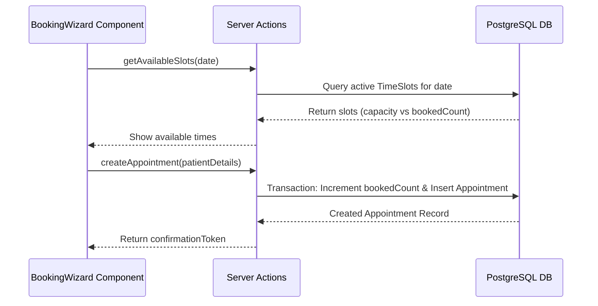
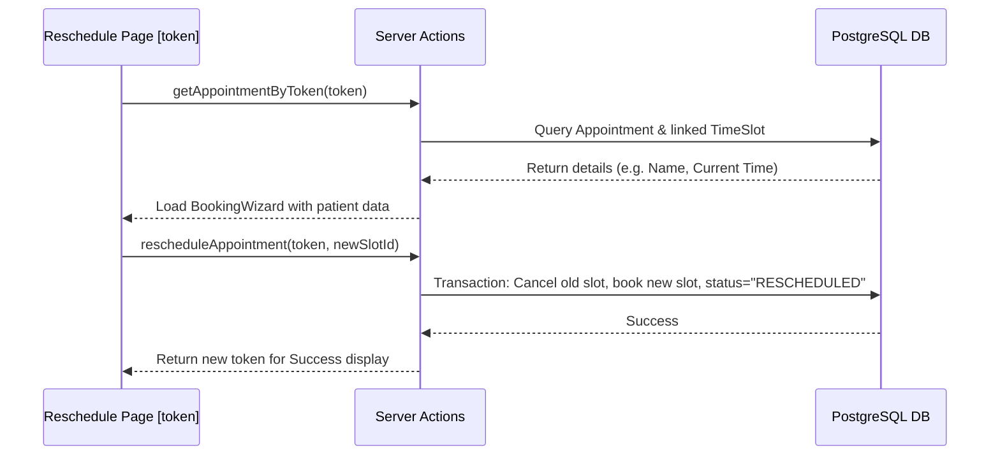

# 🏥 Lakshmi Hair & Skin Hospital - Codebase & Architecture Guide

Welcome to the comprehensive guide for the Lakshmi Hair & Skin Hospital web application. This document details the technology stack, project folder structure, database schema, core program flows, and instructions on how to extend and maintain the application.

---

## 🛠️ Technology Stack & Architecture

This application is built using a modern **Server-First Web Architecture** utilizing:
1. **Next.js (v16.2.9 App Router)**: Uses React 19 and Next.js App Router. Features are split between **React Server Components (RSC)** (for fast page loading and SEO) and **Client Components** (for interactive pages).
2. **Server Actions (RPC-style API)**: Instead of creating traditional REST endpoints, client-side components call asynchronous server functions directly, keeping data queries secure on the server side.
3. **Prisma ORM & PostgreSQL**: A robust relational database schema managed through Prisma, ensuring clean queries, structural transactions, and type-safety.
4. **Tailwind CSS (v4)**: Modern, highly customizable styling engine used with CSS variables for color palettes and layouts.
5. **Lucide React & Framer Motion**: Provides smooth micro-animations and clean vector icons.
6. **Zod & React Hook Form**: Standardized form parsing and runtime data verification on both browser and server.

---

## 📁 File-by-File Breakdown

Below is the directory map of the codebase. Click on any file path to open it directly.

### 1. Database Configuration (`/prisma`)
* **[prisma/schema.prisma](file:///c:/Users/sasig/AndroidStudioProjects/Laskshmi_Clinic_Full/Lakshmi_Hair_User/prisma/schema.prisma)**
  * **Role:** Database structure definition.
  * **Contents:** Models for `TimeSlot` (calendar capacity blocks) and `Appointment` (patient booking details, status, and tokens).
* **[prisma/seed.ts](file:///c:/Users/sasig/AndroidStudioProjects/Laskshmi_Clinic_Full/Lakshmi_Hair_User/prisma/seed.ts)**
  * **Role:** Database initialization script.
  * **Contents:** Code to pre-generate open time slots for the next 30 days so patients have slots to select.

### 2. Server Actions (`/src/actions`)
* **[src/actions/appointment.ts](file:///c:/Users/sasig/AndroidStudioProjects/Laskshmi_Clinic_Full/Lakshmi_Hair_User/src/actions/appointment.ts)**
  * **Role:** The application's backend controller logic.
  * **Contents:**
    * `getAvailableSlots(dateStr)`: Fetches booking slots for a selected date.
    * `createAppointment(data)`: Books slot, saves client data, decrements slot capacity.
    * `cancelAppointment({ token, reason })`: Cancels booking, frees slot capacity.
    * `rescheduleAppointment({ token, newSlotId })`: Database transaction shifting booking to a new slot.
    * `getAppointmentByToken(token)`: Fetches individual records (used by Cancel & Reschedule pages) with mock fallbacks if offline.

### 3. Page Routes (`/src/app`)
Each folder name corresponds to a URL path on the website.
* **[src/app/page.tsx](file:///c:/Users/sasig/AndroidStudioProjects/Laskshmi_Clinic_Full/Lakshmi_Hair_User/src/app/page.tsx)**: The main landing page (`/`).
* **[src/app/book/page.tsx](file:///c:/Users/sasig/AndroidStudioProjects/Laskshmi_Clinic_Full/Lakshmi_Hair_User/src/app/book/page.tsx)**: The main appointment booking page (`/book`).
* **[src/app/book/cancel/[token]/page.tsx](file:///c:/Users/sasig/AndroidStudioProjects/Laskshmi_Clinic_Full/Lakshmi_Hair_User/src/app/book/cancel/[token]/page.tsx)**: Cancellation page (`/book/cancel/<token>`).
* **[src/app/book/reschedule/[token]/page.tsx](file:///c:/Users/sasig/AndroidStudioProjects/Laskshmi_Clinic_Full/Lakshmi_Hair_User/src/app/book/reschedule/[token]/page.tsx)**: Rescheduling page (`/book/reschedule/<token>`).
* **[src/app/api/cron/reminders/route.ts](file:///c:/Users/sasig/AndroidStudioProjects/Laskshmi_Clinic_Full/Lakshmi_Hair_User/src/app/api/cron/reminders/route.ts)**: Cron endpoint `/api/cron/reminders` called every 15 mins to send automated WhatsApp reminders.
* **[src/app/globals.css](file:///c:/Users/sasig/AndroidStudioProjects/Laskshmi_Clinic_Full/Lakshmi_Hair_User/src/app/globals.css)**: Master style sheet housing custom CSS variables and Tailwind configuration directives.
* **[src/app/layout.tsx](file:///c:/Users/sasig/AndroidStudioProjects/Laskshmi_Clinic_Full/Lakshmi_Hair_User/src/app/layout.tsx)**: Global HTML layout wrapping all pages (includes Header, Footer, Font configuration).

### 4. Helper Libraries (`/src/lib`)
* **[src/lib/prisma.ts](file:///c:/Users/sasig/AndroidStudioProjects/Laskshmi_Clinic_Full/Lakshmi_Hair_User/src/lib/prisma.ts)**: Prevents Prisma connection pool exhaustion by caching database clients during hot-reloads.
* **[src/lib/slots.ts](file:///c:/Users/sasig/AndroidStudioProjects/Laskshmi_Clinic_Full/Lakshmi_Hair_User/src/lib/slots.ts)**: Hospital hours logic (e.g. 9:00 AM - 5:00 PM, 30-min intervals) and date parsing functions.
* **[src/lib/validations.ts](file:///c:/Users/sasig/AndroidStudioProjects/Laskshmi_Clinic_Full/Lakshmi_Hair_User/src/lib/validations.ts)**: Zod schemas to validate form inputs.
* **[src/lib/whatsapp.ts](file:///c:/Users/sasig/AndroidStudioProjects/Laskshmi_Clinic_Full/Lakshmi_Hair_User/src/lib/whatsapp.ts)**: Constructs WhatsApp notification text and sends API requests.
* **[src/lib/data/](file:///c:/Users/sasig/AndroidStudioProjects/Laskshmi_Clinic_Full/Lakshmi_Hair_User/src/lib/data)**: Static data arrays (FAQ entries, Doctor list, Testimonials) displayed on the frontend.

### 5. UI Components (`/src/components`)
* **[src/components/layout/Header.tsx](file:///c:/Users/sasig/AndroidStudioProjects/Laskshmi_Clinic_Full/Lakshmi_Hair_User/src/components/layout/Header.tsx)** & **[Footer.tsx](file:///c:/Users/sasig/AndroidStudioProjects/Laskshmi_Clinic_Full/Lakshmi_Hair_User/src/components/layout/Footer.tsx)**: Header and footer elements.
* **[src/components/booking/BookingWizard.tsx](file:///c:/Users/sasig/AndroidStudioProjects/Laskshmi_Clinic_Full/Lakshmi_Hair_User/src/components/booking/BookingWizard.tsx)**: The main multi-step wizard component that handles treatment choice, time selection, details, OTP, and success displays.
* **[src/components/home/](file:///c:/Users/sasig/AndroidStudioProjects/Laskshmi_Clinic_Full/Lakshmi_Hair_User/src/components/home)**: Landing page component widgets (Hero, Stats, Reviews, etc.).

---

## 🗄️ Database Models Explained

The PostgreSQL database maintains two interconnected models:

### 1. `TimeSlot` (Stores dates & times)
| Field | Type | Description |
|---|---|---|
| `id` | String | Unique identifier (CUID) |
| `date` | DateTime | The day of the slots (Y-M-D) |
| `startTime` | String | e.g., `"10:30 AM"` |
| `endTime` | String | e.g., `"11:00 AM"` |
| `capacity` | Int | Max bookings allowed in this slot (default: `2`) |
| `bookedCount` | Int | Number of current bookings (default: `0`) |
| `isActive` | Boolean | True if the clinic is open for booking in this slot |

### 2. `Appointment` (Stores bookings)
| Field | Type | Description |
|---|---|---|
| `id` | String | Unique identifier (CUID) |
| `slotId` | String | Foreign key pointing to a `TimeSlot` record |
| `fullName` | String | Patient's name |
| `phone` | String | Patient's phone number |
| `email` | String? | Optional email |
| `age` | Int | Patient's age |
| `gender` | Enum | `MALE` / `FEMALE` / `OTHER` |
| `patientType` | Enum | `NEW` (first visit) / `FOLLOW_UP` |
| `status` | Enum | `CONFIRMED` / `CANCELLED` / `COMPLETED` / `NO_SHOW` / `RESCHEDULED` |
| `confirmationToken`| String | Unique string used in SMS/WhatsApp cancel/reschedule URLs |

---

## 🔄 Core Application Flows

### 1. Booking Flow


### 2. Rescheduling Flow


---

## 🛠️ Developer Actions: "If I want to change..."

### 1. If I want to change a database table or add fields
* **What to edit:** [prisma/schema.prisma](file:///c:/Users/sasig/AndroidStudioProjects/Laskshmi_Clinic_Full/Lakshmi_Hair_User/prisma/schema.prisma).
* **Command to run:**
  ```bash
  # Push schema structural changes to the database
  npx prisma db push
  
  # Regenerate type configurations
  npm run db:generate
  ```
* **Follow-up:** Update validation schemas in [src/lib/validations.ts](file:///c:/Users/sasig/AndroidStudioProjects/Laskshmi_Clinic_Full/Lakshmi_Hair_User/src/lib/validations.ts) and form structures in [src/components/booking/BookingWizard.tsx](file:///c:/Users/sasig/AndroidStudioProjects/Laskshmi_Clinic_Full/Lakshmi_Hair_User/src/components/booking/BookingWizard.tsx) to match the new database properties.

### 2. If I want to modify clinic timings or slot capacity
* **What to edit:** Adjust configuration variables in [src/lib/slots.ts](file:///c:/Users/sasig/AndroidStudioProjects/Laskshmi_Clinic_Full/Lakshmi_Hair_User/src/lib/slots.ts).
  * `START_HOUR` / `END_HOUR`: Adjust business hours.
  * `SLOT_DURATION`: Time in minutes (default `30`).
  * `capacity` in [prisma/seed.ts](file:///c:/Users/sasig/AndroidStudioProjects/Laskshmi_Clinic_Full/Lakshmi_Hair_User/prisma/seed.ts) (default slots limit).
* **Command to run:**
  ```bash
  # Re-populate database with slots aligned with new settings
  npm run db:seed
  ```

### 3. If I want to add new links, layout menus, or styles
* **For styles:** Edit [src/app/globals.css](file:///c:/Users/sasig/AndroidStudioProjects/Laskshmi_Clinic_Full/Lakshmi_Hair_User/src/app/globals.css). CSS edits are compiled in real-time.
* **For headers/footers:** Edit [src/components/layout/Header.tsx](file:///c:/Users/sasig/AndroidStudioProjects/Laskshmi_Clinic_Full/Lakshmi_Hair_User/src/components/layout/Header.tsx) or [Footer.tsx](file:///c:/Users/sasig/AndroidStudioProjects/Laskshmi_Clinic_Full/Lakshmi_Hair_User/src/components/layout/Footer.tsx).

---

## 🧹 Troubleshooting & Caches
If you rename folders, move files, or run into sudden local compilation glitches, run these cache cleanup commands in your PowerShell console to rebuild fresh:

```powershell
# Clear local Next.js cache and TypeScript incremental cache
Remove-Item -Recurse -Force .next, tsconfig.tsbuildinfo -ErrorAction SilentlyContinue

# Regenerate Prisma Client definitions
npm run db:generate
```
